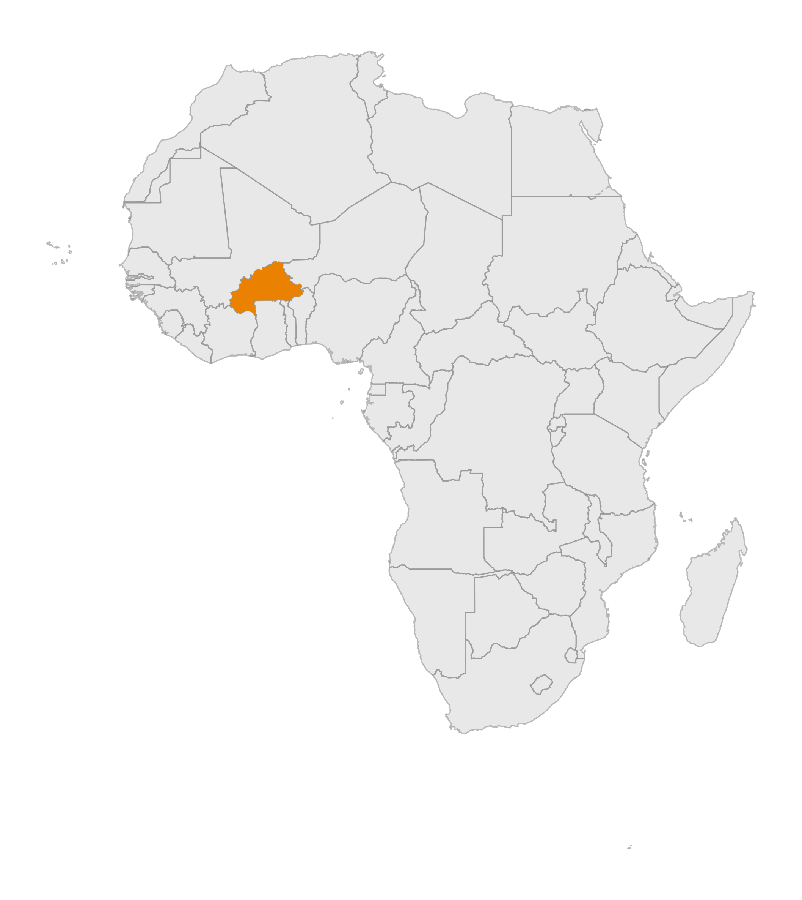

Maps of the country
...................

	   

Before you start, you need to create your environment by

.. code-block:: console

   conda env create -f countrymap.yml

To make your plots of africa highlighting a specific country you can apply the following notebook

.. code-block:: console

   $ Notebooks/COUNTRY_MAPS/read_nuts_2024_africa.ipynb

You also need the input file **ne_10m_admin_0_countries.shp** which is availbale here:

https://www.naturalearthdata.com/downloads/10m-cultural-vectors/
  
