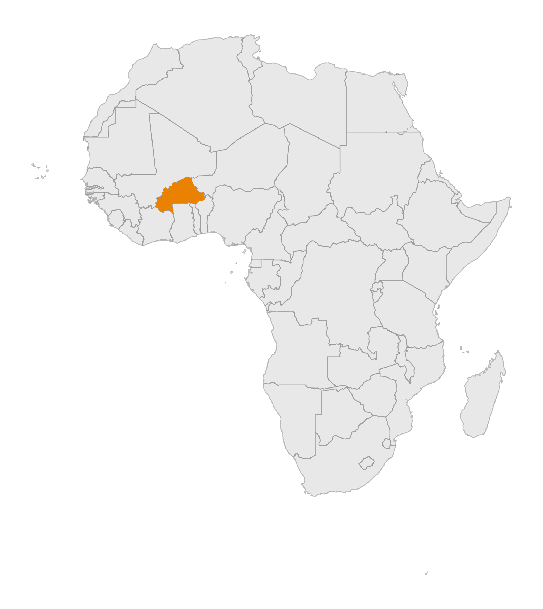

==========================
GERICS Factsheets - Africa
==========================

|license|  |doi|

	   
In diesem Repositorium sind die Klimadatenanalysen zusammengestellt, die in der GERICS Broschüre *Climate Factsheet Africa* enthalten sind. Die Skripte zur Datenverarbeitung sind hier ebenfalls zu finden, und sie ermöglichen die Reproduktion der Grafiken und Tabellen aus der GERICS Broschüre. Darüber hinaus enthält das Repositorium Hintergrundinformationen zu den Berechnungen der globalen Erwärmungsstufen und zusätzliche Analysen.

Kontakt
.......

If you have any issues or requests, please do not hesitate to contact us:

katharina.buelow@hereon.de or torsten.weber@hereon.de

.. |license| image:: https://img.shields.io/badge/License-MIT-yellow.svg
    :target: https://opensource.org/licenses/MIT

.. |doi| image:: https://zenodo.org/badge/DOI/10.5281/zenodo.11476347.svg
    :target: https://doi.org/10.5281/zenodo.11476347
