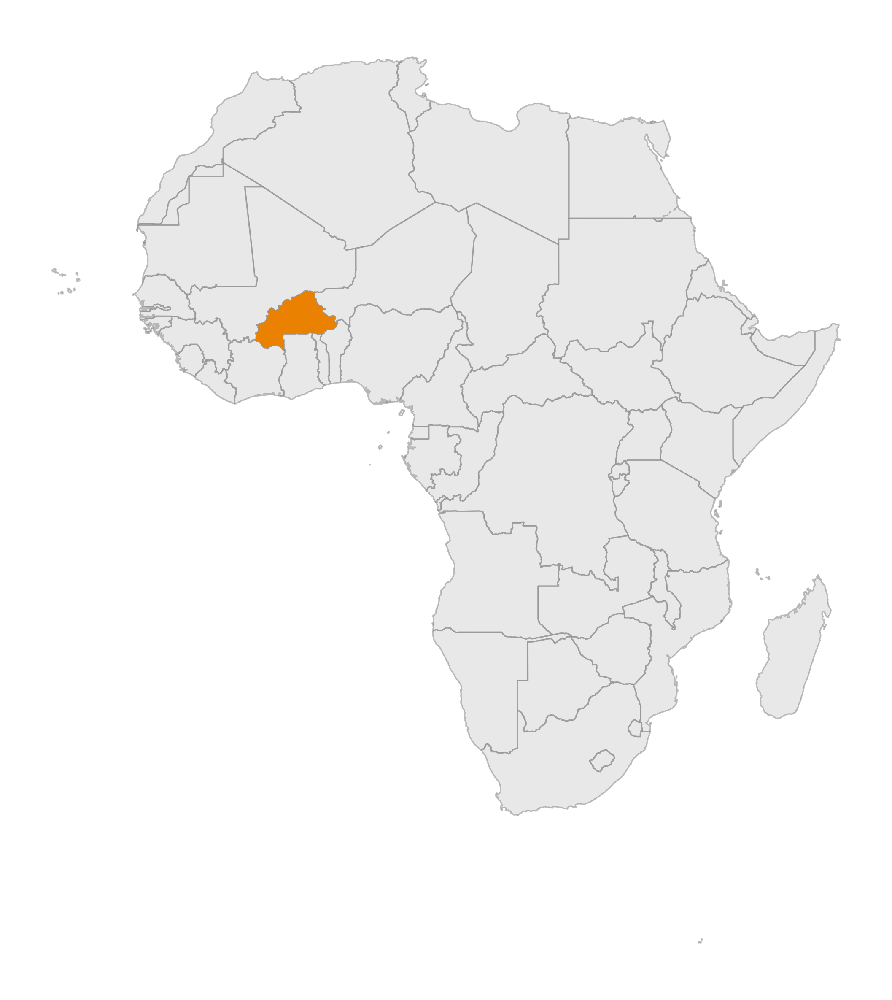

==========================
GERICS Factsheet - Africa
==========================

|license|  |doi|

	   
This repository contains the climate data analyses included in the GERICS Climate Factsheet Africa. The scripts for data processing are also provided here, enabling the reproduction of the graphics and tables from the GERICS fact sheet. 

Kontakt
.......

If you have any issues or requests, please do not hesitate to contact us:

katharina.buelow@hereon.de or torsten.weber@hereon.de

.. |license| image:: https://img.shields.io/badge/License-MIT-yellow.svg
    :target: https://opensource.org/licenses/MIT

.. |doi| image:: https://zenodo.org/badge/DOI/10.5281/zenodo.11476347.svg
    :target: https://doi.org/10.5281/zenodo.11476347
